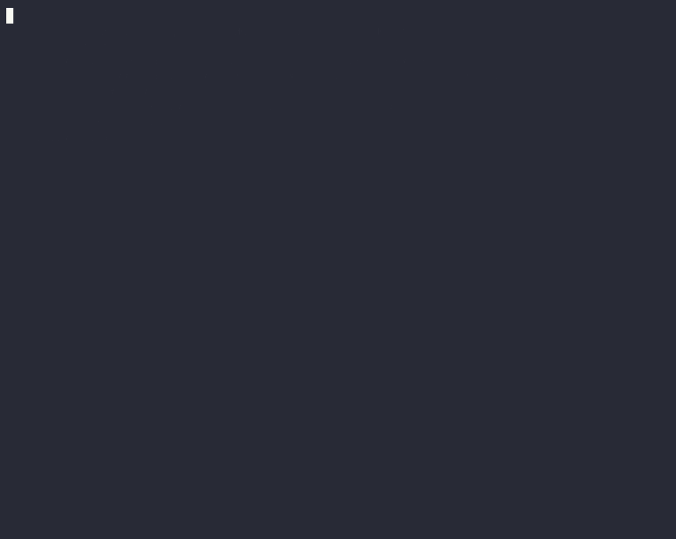

# KairoCode

A coding agent that picks up where it left off after a crash, never runs a side effect twice, and can wait hours for your approval without holding a process.



**See it for yourself:** [kill -9 it in the middle of a five-step flow](docs/durability.md). It goes on from where it was, asks about the one step that was cut off, and every step happens once. It takes a minute and needs no API key: `scripts/demo-durability.sh`.

KairoCode runs each session as a workflow on [kairo](https://github.com/r-hashi01/kairo), a durable workflow runtime. It is the same kind of tool as Claude Code or opencode, with these guarantees:

- **It survives crashes.** `kill -9` the process and the next one continues from where it stopped. Model calls and tool runs that already finished are not repeated.
- **Side effects happen once.** If the outcome of a real effect — a `git push`, an HTTP POST — is unknown, KairoCode does not retry it on its own; it asks you whether it took effect. File writes are checked against content hashes before going on.
- **It can wait as long as it takes.** While waiting for an approval it lets go of the process. You can answer later, from the terminal, an editor or the CLI.
- **The same rules on any engine.** Besides the Claude API, it can drive your own Claude Code, Codex or GitHub Copilot CLI, or any ACP agent. Permission rules, the sandbox and the record stay KairoCode's.
- **Procedures become durable flows.** Write a fixed procedure as a Starlark flow (`.kairocode/workflows/*.star`), or have one written from a description; look at its chart, try it, then use it. A flow that crashes midway does not redo the steps it finished.

> This is the first release (v0.1). Commands and settings may still change.

## Platforms

- macOS (uses `sandbox-exec`; nothing else to install)
- Linux (needs `bwrap` from [bubblewrap](https://github.com/containers/bubblewrap), and user namespaces)
- Windows is not supported (there is no sandbox for it).

## Install

| How | Command |
|---|---|
| Homebrew (macOS, Linux) | `brew install r-hashi01/tap/kairocode` |
| Go | `go install github.com/r-hashi01/kairocode/cmd/kairocode@latest` (does not create the `kairo` link) |
| Binaries | Download the tar.gz for your OS and CPU from [Releases](https://github.com/r-hashi01/kairocode/releases) and put `kairocode` and `kairo` on your `PATH` |
| Source | `git clone https://github.com/r-hashi01/kairocode && cd kairocode && make build` (Go 1.27.2 or later; builds `bin/kairocode` and `bin/kairo`) |

`kairo` is the same as `kairocode chat`: it opens the terminal UI. `kairocode version` prints the version.

The macOS binaries are not notarized by Apple. If one you downloaded with a browser is blocked, run `xattr -d com.apple.quarantine kairocode kairo` (binaries installed with Homebrew or `curl` run as they are).

## Getting started

Pick an engine for the model.

| Engine | What it uses | How to choose it |
|---|---|---|
| `anthropic` (default) | The Claude API, with whatever credentials Anthropic's SDK reads (`ANTHROPIC_API_KEY`, ...) | Nothing to do |
| `claude-code` | Your own Claude Code (signed in with your subscription) | `/provider`, or `KAIROCODE_ENGINE=claude-code` |
| `codex` | Your own Codex CLI | Same |
| `copilot` | Your own GitHub Copilot CLI | Same |
| `oai:<name>` | An OpenAI-compatible API, run in KairoCode's own loop: `oai:openai` (`OPENAI_API_KEY`), `oai:ollama` (a local Ollama), or one you name (below) | Same |

`/provider` in the chat can also install an agent from the ACP registry and use it. Choose the model with `/model` (or `KAIROCODE_MODEL`).

### Local models and other OpenAI-compatible APIs

Any server that speaks OpenAI's Chat Completions API can run the model: OpenAI, Ollama, LM Studio, llama.cpp's server, vLLM, OpenRouter and others. Name it in your own `~/.config/kairocode/kairocode.json`:

```json
{"providers": {
  "lmstudio": {"baseURL": "http://localhost:1234/v1", "model": "qwen3-coder-30b"},
  "lab": {"baseURL": "https://llm.example.com/v1", "keyEnv": "LAB_API_KEY",
          "models": {"qwen3-coder": {"context": 262144}}}
}}
```

- `/provider oai:lmstudio` (or `-provider oai:lmstudio`) switches to it; `/model` lists what the server has.
- `keyEnv` names the environment variable the key is in, where the daemon starts. The key is sent over https only, or to this machine, and is kept out of the record.
- A model's `context` (128,000 tokens unless given) is when the conversation is summarized.
- Only your own settings name providers: a project's `kairocode.json` cannot choose where the conversation is sent.
- Ollama serves its OpenAI-compatible API with a small context (a few thousand tokens), and cuts a longer request short without an error. KairoCode's instructions and tools alone are over 10,000 tokens: start Ollama with `OLLAMA_CONTEXT_LENGTH=32768` (or more), and give the model the same `context` in your settings.
- How well the model calls tools is its own: pick one made for tool use. Its tool calls are KairoCode's tools, with the same permissions, sandbox and record ([ADR 0035](docs/adr/0035-openai-compatible-providers.md)).

## Usage

```sh
kairo                                # the terminal UI; asks whether to trust a folder the first time
kairocode run "fix the tests"        # do one task without a conversation, then exit
kairocode run -detach "…"            # stop where a person must approve, and exit (exit code 3)
kairocode resume <session>           # go on from there
kairocode approvals <session>        # the approvals waiting
kairocode approve [-deny] <key>      # answer an approval (from any terminal)
kairocode answer <key> <answer>      # answer a flow's question
kairocode log <session>              # the session's record: turns, model input and output, tools, waits, usage
kairocode sessions                   # the sessions of this folder
kairo -worktree[=name]               # a session in a new git worktree, on a branch kairo/<name> (run takes -worktree too)
kairocode sessions -repo             # the repository's sessions across its worktrees: what each does, how each differs
kairocode fork [-files] <session> [turn]   # go on from a past turn, as another session
kairocode plugin install <name>      # install a plugin (MCP servers and skills); connect gives it credentials
kairocode usage [-session <session>]  # what was used today, this week (and in a session), against your limits
```

`kairocode help` lists every command. One daemon runs the sessions of each data directory (`~/.local/share/kairocode` by default). Commands start it as needed, and it stops after 10 minutes without use.

### In the terminal UI

- `/help`, `/model`, `/provider`, `/effort`, `/login`
- `/undo`, `/redo`: put the working files back as they were before the last turn, and back again (the record is kept)
- `/compact`: summarize the conversation and go on from the summary (also done on its own near the context limit)
- `/init`: read the repository and write a draft `AGENTS.md` (or improve the one there); `kairocode run /init` does it too
- `/fork`: go on from a past turn, as another session
- `/flow`: flows (see below)
- `/plugin`, `/skills`, `/mcp`: plugins, skills, MCP servers
- `/log`, `/resume`, `/review`
- `/usage`: what has been used in this session, today and this week, against your limits: a bar and a percentage for each, and when it resets, as in Claude Code's `/usage` and Codex's `/status`. The status line shows the session's tokens and cost, and a limit 80% used is warned of once, after a turn.
- `/new`: another session in this terminal; `/new --worktree [name]`, in a new git worktree on `kairo/<name>`, so sessions work side by side without seeing each other's changes. Worktrees live in the data directory (`worktrees/`), not in the repository; files git does not track (`.env`, installed dependencies) are not in a new one.
- `/sessions`: the repository's sessions across its worktrees: whether each is working or waits for you, and how its worktree differs. Enter takes one up; `d` removes a worktree whose sessions rest (its branch is kept if not merged).
- Type a space after a command's name to see what it takes (`/plugin install <name>`, `/flow new`, your flows' names, `/model`'s models, ...). Tab or ↑↓ picks one; Enter sends what you typed.
- Shift+Tab switches the approval mode: manual, auto, plan. The input's `>` takes the mode's color.
- Esc stops the current turn. Ctrl-C twice leaves.
- `@path` attaches a file. Shift+Enter adds a new line.
- Images: Ctrl+V pastes the clipboard's image (Cmd+V too, when the clipboard holds only an image), or drop an image file on the terminal. It shows as `[Image #1]` in the input and is sent with the message. On Linux this needs `wl-paste` or `xclip`.
- A large paste (over 10 lines or 1,000 characters) is folded in the input as `[Pasted text #1 +42 lines]` and sent in full.
- Messages typed during a turn are sent when it ends.
- Long commands (tests, builds, servers) can run in the background: the model reads their output or waits for them later. They keep running when the daemon is replaced.
- Notifications: when the terminal is not focused and KairoCode waits for an approval or a question, or a turn ends, it tells you with a terminal notification (iTerm2, WezTerm, Ghostty, kitty) or the bell. Set `"notify"` in `~/.config/kairocode/kairocode.json` to `"unfocused"` (default), `"always"` or `"never"`. To hear of them away from the machine (in Slack, say), bind a flow to `approval.requested`: [docs/notify.md](docs/notify.md).
- If a session stops on a storage error, a new session goes on from its last finished turn (the old session's record is kept).

### From an editor (ACP)

`kairocode acp` is an [ACP](https://agentclientprotocol.com) agent over standard input and output. In Zed or another editor that speaks ACP, set the command to `kairocode` and the arguments to `acp`.

## Flows

Write a fixed procedure in Starlark, in `.kairocode/workflows/<name>.star`.

```python
DESCRIPTION = "Review the changes, then summarize them"

def main(input):
    phase("review")
    r = agent(agent = "plan", prompt = "Review the current diff: " + input["args"])
    if not r.ok:
        return {"ok": False, "message": r.error}
    return {"ok": True, "message": r.output}
```

- What a flow can call: `agent` (a subagent), `parallel`, `tool`, `ask` (ask a person), `decide` (a typed decision), `check` (one of the project's checks, below), `phase`.
- Run one with `/flow <name> <args>`. `/flow new <description>` has one written from your words; you check its chart and try it before it is saved. `/flow new --from-session [what to make of it]` has one written from what this session did (the record: what was asked, the tools called, the approvals), to do it again; `--from-session=<id>` takes another session of the folder.
- In the terminal UI, `/flow` alone opens the list of flows. Pick one to see how it is used and its chart, then run it, change it on its chart (`e`), or look at its past runs (`r`). The last row, "make a new flow", starts `/flow new`.
- `kairocode flow graph <name>` draws a flow, `kairocode flow show -follow <session>` shows one as it runs, and `kairocode flow runs` lists past runs.
- If it crashes midway, the `agent` and `tool` calls that finished are not run again.

## Checks: who decides the work is done

Declare the commands that tell whether work is done, in `kairocode.json`. Work they gate is done only when they pass, not when the model says so:

```json
{"checks": {
  "test": {"command": "go test ./...", "timeout": "10m", "protect": ["*_test.go", "testdata/*"]},
  "lint": {"command": "golangci-lint run"},
  "turn": ["lint"],
  "rounds": 3
}}
```

- A flow gates an agent with them: `agent("build", "make the tests pass", checks = ["test"])`. When a check fails, the agent is sent back with its output, up to `rounds` times; then `.ok` is `False`, `.error` is `"checks"`, and `.checks` has each check's verdict, for the flow to decide what follows. `check("test")` runs one as a step of its own.
- `turn` names the checks a plain turn (the chat, `kairocode run`) must pass. A turn that cannot get them to pass stops with `checks`, and its reply says it is not done. With no `turn`, a turn is not checked, as before.
- A check runs in KairoCode's sandbox: it may write in the project only, with no network but this machine's. It gets a build cache of the repository's own (`GOCACHE`, `XDG_CACHE_HOME`), not your shared one, which nothing in the sandbox may write. A project's check is asked about before it first runs in a folder. A check cut off by a crash runs again; the agent is not asked again.
- `protect`: files the gated work may not change (`*` crosses `/`). `edit` and `write` refuse them, and a change by any other means fails the gate. Protect only what the check reads: a check that writes a file it protects fails its own gate.
- Each check's run and verdict are in the record (`kairocode log`), and `kairocode flow stats` shows how often each flow's gates passed at once, after rounds, or not at all.

## Lines and work items: work behind the conversation

A line is a row of stations a request goes down, from the request to a change ready to merge (ADR 0043, `docs/factory.md`). Declare the project's lines in `.kairocode/lines/<name>.json`:

```json
{
  "description": "From a request to a branch ready to merge, its tests passing",
  "stations": [
    {"name": "plan",   "agent": "plan",  "prompt": "Write the plan: files to change, tests to add."},
    {"name": "build",  "agent": "build", "checks": ["test"], "rounds": 3},
    {"name": "review", "flow": "review"},
    {"name": "verify", "checks": ["test", "lint"]}
  ]
}
```

- **Stations.** Each station has one machine and the gate at its exit:
  - an `agent` (with a `prompt`), given the request and what the stations before it left;
  - a `flow` of the project's (with `args`, else the request);
  - neither, so the station is its `checks` alone.

  An agent whose checks fail is sent back, up to `rounds` times, as in a flow. A flow whose checks fail stops the line there.
- **Starting an item.** In the conversation, KairoCode sends a request down a line with the tool `line`. It names a standard line and says why, or proposes one put together on the spot, which you are always asked about (`"lines": {"onTheSpot": "deny"}` refuses those). You can name one yourself: `/line <name> <request>`, or `kairocode line <name> "<request>"`.
- **Each item runs in its own worktree**, on the branch `kairo/<line>-<n>`, as a session of its own, behind the conversation. When every station passes, its work is committed to that branch, ready to merge.
- **Told back.** The conversation is told when an item ends or waits for you.
  - `/items` (or `kairocode items <session>`) lists the items: their line, station, state, branch and cost.
  - `/items` also lists what the items wait for. Answer by number with `/items yes 1` or `/items answer 2 <option>`, or use `kairocode approvals <session>`.
  - At most 4 items run at once in a repository.
- **Cleaning up.** Merge an item's branch and it is cleaned up (its worktree removed, its session closed); `/items drop <item>` drops one. `/line keep <item> <name>` keeps a line put together on the spot as `.kairocode/lines/<name>.json`, for you to review and commit.

## Permissions and the sandbox

Write rules per tool in `kairocode.json` (yours in `~/.config/kairocode/kairocode.json`, the project's at the repository's root). The format is opencode's; a later rule wins.

```json
{
  "permission": {
    "bash": { "*": "ask", "git status*": "allow", "rm -rf*": "deny" },
    "edit": "allow"
  }
}
```

Commands KairoCode runs run in the OS sandbox. They can write only the working directory and the temporary directory, and even there `.git`, `.kairocode`, `.claude` and the like are protected. There is no network. Running a command outside the sandbox asks you every time by default.

For commands that talk to a local server, such as tests, the model can pick a local-only sandbox (`loopback`). It reaches ports on this machine, but not other machines, and not KairoCode's own approval endpoint. If you would rather decide each time, set `"sandbox": {"loopback": "ask"}`, or `"deny"`.

A project's settings (permissions, hooks, MCP servers) are not read until you say you trust its folder. Hooks (commands) in Claude Code's settings ask before their first run whether to run inside the sandbox, outside it, or not at all. `"agents": {"claudeHooks": "off"}` stops reading them.

### What `kairocode.json` sets

| Key | Meaning | Where |
|---|---|---|
| `permission` | Rules per tool (above) | Yours, the project's |
| `sandbox.loopback` | The local-only sandbox: `allow` (default), `ask` or `deny` | Yours (a project can only make it stricter) |
| `hooks` | Flows run at points such as the end of a turn, or when a person is needed (`approval.requested`, [docs/notify.md](docs/notify.md)) | Yours, the project's |
| `mcp`, `tools` | MCP servers, and your own tools written as commands | Yours, the project's |
| `lsp` | Language servers that check the files written (`false` turns them off) | Yours, the project's |
| `agents.claudeHooks` | Claude Code's hooks: `ask` (default) or `off` | Yours (a project can only turn them `off`) |
| `http` | Credentials for the `http` and `fetch` tools (`auth`), and whether local addresses are allowed (`allowPrivate`) | Yours |
| `models.<name>.context` | A model's context length (when summarizing starts) | Yours |
| `models.<name>.price` | A model's price in US dollars per million tokens (`input`, `output`, `cache_read`, `cache_write`), for a model KairoCode does not know or to correct one | Yours |
| `checks` | Commands that decide when work is done, the checks a plain turn must pass (`turn`) and how often they send it back (`rounds`, 3). See [Checks](#checks-who-decides-the-work-is-done) | Yours, the project's (a project's check is asked about first) |
| `lines.onTheSpot` | Whether KairoCode may put a line together on the spot: `ask` (default; always asked) or `deny`. See [Lines](#lines-and-work-items-work-behind-the-conversation) | Yours, the project's (the stricter) |
| `limits` | Limits that stop a turn before its next model call: `turn.steps` (50), `turn.time` (`"30m"`; waits for you not counted), and `tokens` or `cost` (US dollars) for `session`, `day` (from 00:00) and `week` (from Monday); `warn` (0.8) is when you are warned. See below | Yours, the project's (the smaller of each) |
| `providers` | OpenAI-compatible APIs, local models among them (above) | Yours only |
| `rateLimits` | Requests (`rpm`) and tokens (`tpm`) a minute, by provider: `anthropic`, or an OpenAI-compatible provider's name. Calls of every session wait their turn, and a 429 holds them back as long as it asks | Yours, the project's (the smaller of each) |
| `flowHistory` | How many flow runs to keep (`keep`) and for how many days (`days`) | Yours |
| `notify`, `language` | How to notify, and the language shown | Yours |

## Usage and limits

Every model call is counted in the daemon's ledger, with what it cost: Claude models at Anthropic's prices, local models at nothing, others at the price you set (`models.<name>.price`), and Claude Code at the cost it reports. `/usage` and `kairocode usage` show it. Limits are set in `kairocode.json`:

```json
{"limits": {"session": {"cost": 5}, "day": {"cost": 20}, "week": {"cost": 100}, "turn": {"time": "30m"}}}
```

Rate limits keep the calls of every session, agent and flow to one provider within its requests and tokens a minute: `{"rateLimits": {"anthropic": {"rpm": 50, "tpm": 30000}}}`. A call that would go past them waits its turn, and a 429 ("too many requests", or Anthropic's "overloaded") holds every call to that provider back for as long as it asks, and the call is asked again (up to 5 times; a call waits 5 minutes at most, and one that would wait longer, for a daily quota say, fails at once with the provider's message). The status line says so while a call waits; `/usage` shows the limits and how often today a provider said to wait.

A turn that reaches one stops before its next model call and says which limit, and when it resets; the next turn stops at once while it stays reached. A turn keeps the limits it started with. A model whose cost is not known does not count towards a cost limit (`/usage` names it). The limits of a CLI engine's own plan (a Claude subscription, ChatGPT for codex) are not KairoCode's to see: their own `/usage` or `/status` shows them.

## Development

How the work is done is in [AGENTS.md](AGENTS.md), design decisions in [docs/adr](docs/adr/README.md), and progress in [docs/milestones.md](docs/milestones.md) (these are in Japanese).

```sh
scripts/check.sh            # gofmt, vet, build, all tests (-race, including the crash tests), invariants, ADRs
scripts/check.sh --quick    # the light version
```

## License

[MIT](LICENSE). What is in `third_party/` follows its own license: the macOS sandbox policy in `third_party/codex-sandbox` comes from OpenAI Codex, under the Apache License 2.0 ([LICENSE](third_party/codex-sandbox/LICENSE), [NOTICE](third_party/codex-sandbox/NOTICE)).
