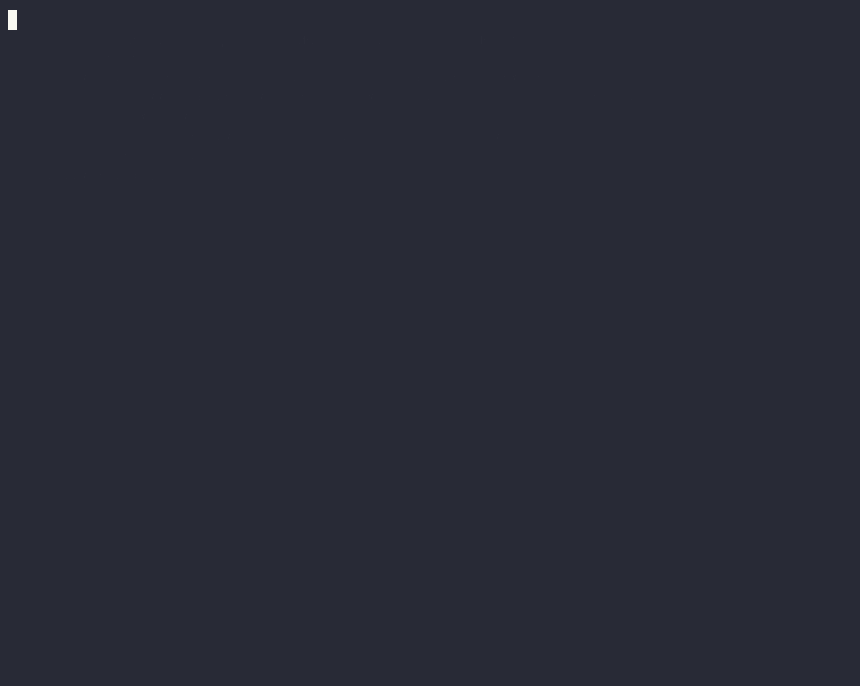

# Durability: kill it in the middle, and nothing happens twice

KairoCode runs every session as a [kairo](https://github.com/r-hashi01/kairo) workflow. This page shows what that buys you, with a demo you can run in a minute, without an API key.

## The demo



A flow of five steps. Each one is a real command: it writes its name to `ledger.txt`, then takes two seconds.

```python
def main(input):
    for step in ["build", "test", "tag", "publish", "announce"]:
        r = tool("bash", command = "echo " + step + " >> ledger.txt; sleep 2")
        if not r.ok:
            return "stopped at " + step + ": " + r.error
    return "released"
```

In the middle of `tag`, the daemon that runs it is killed with `kill -9`. Then:

1. The client starts the daemon again, and the flow goes on from where it was. `build` and `test` are not run again: their results are read back from the record.
2. `tag` was cut off while it ran. KairoCode cannot know whether it took effect, so it does not run it again on its own. It asks:

   ```
   Cut off while it ran — did it take effect? bash echo tag >> ledger.txt; sleep 2
     kairocode approve review:s/…   (or -deny: it did not)
   ```

3. `ledger.txt` has `tag`, so the answer is "it did". The flow runs `publish` and `announce`, and returns `released`.
4. `ledger.txt` has five lines, none twice.

### Run it

From a clone of this repository:

```sh
scripts/demo-durability.sh
```

It uses `kairocode` on your `PATH`, or builds it (`KAIROCODE=/path/to/kairocode` picks another). Everything happens in a new temporary folder with its own data directory: the daemon you use is not touched. The model is scripted (the fake provider), because the demo is about the runtime; a session with a real model resumes the same way.

The recording above is this script, recorded with [asciinema](https://asciinema.org) and turned into a GIF with [agg](https://github.com/asciinema/agg): `make demo-gif` records it again (`brew install asciinema agg`).

### By hand

```sh
mkdir -p demo/.kairocode/workflows && cd demo && git init -q
# the flow above, as .kairocode/workflows/release.star
echo '{"permission": {"bash": "allow"}}' > kairocode.json
echo '{"hold_at": -1, "script": [{"text": "Release"}, {"text": "ok"}]}' > ../fake.json
export KAIROCODE_PROVIDER=fake KAIROCODE_FAKE=$PWD/../fake.json

kairocode run -data ../data -detach "/flow release" &
# once ledger.txt has "tag":
kill -9 "$(sed -n 's/.*"pid":\([0-9]*\).*/\1/p' ../data/server.json)"
wait                                   # it stops for you (exit 3)
kairocode approvals -data ../data <session>
kairocode approve -data ../data <key>  # tag took effect
kairocode resume -data ../data <session>
cat ledger.txt
```

`-data ../data` keeps it apart from your own daemon. Leave it out, and the daemon you use is the one killed.

## Why it works

- **Each step is recorded before it runs.** Every model call and tool call is a run of kairo, and a call with a real effect starts only after its intent is in the database. A step that finished has its result recorded; on resume, the flow (or the agent loop) runs again from the top, and finished steps return their recorded results instead of running.
- **The next daemon takes over at once.** The daemon has one name in kairo's leases (`kairocode-daemon`). A new daemon under that name takes the steps its earlier self was running as stopped, without waiting for their leases to run out.
- **A step cut off is never taken for done, nor run again blindly.** What happens depends on the tool's declared effect:

  | Effect | Tools | Cut off midway |
  |---|---|---|
  | Read | `read`, `grep`, `fetch`, … | Run again: it changes nothing |
  | Idempotent | `write`, `edit`, `git_commit`, `git_push`, … | Checked, then finished: the file's hash before and after the write, or what the branch points at, tells whether it was done |
  | Real | `bash`, `http`, MCP tools, … | Stopped for a person: "did it take effect?" The answer goes back to kairo, and the flow goes on from it |

- **Waiting holds no process.** A turn that waits for an approval is a kairo wait. The daemon can stop, and the answer, given later, wakes it.

The same holds for a chat session, a subagent, and a flow started by a hook, and for whichever engine runs the model ([README](../README.md#getting-started)).

## With Claude Code or codex as the engine

KairoCode can leave the model loop to another agent: Claude Code, or codex (`-provider claude-code`, `-provider codex`, or `/provider` in the chat). The agent then decides what to call, and keeps the conversation in its own record. The guarantees above still hold, because what the agent does to your files and your machine goes through KairoCode:

- **Its tools are KairoCode's.** Claude Code is started with its built-in tools off and KairoCode's tools on an MCP server (ADR 0007). codex is started with its own shell off, so KairoCode's `bash` is its only shell, and it has KairoCode's tools on the same MCP server; the files it writes and the terminals it opens through ACP's client calls are KairoCode's `write` and `bash` too (ADR 0014, 0015). Each call is a run of kairo, named from the tool and its input: the same rules, effects and sandbox as with the Claude API.
- **After a crash, the agent is resumed, and its calls meet the record.** The next daemon stops what is left of the agent, and resumes it from its own record (`claude --resume`, ACP's `session/load`), telling it to go on. When it makes a call again, the call finds the run it made before: a finished one returns its result, and one cut off waits for a person, as in the demo above. The agent is told to stop and wait, and the turn waits without holding a process.
- **What the agent would do by itself asks first.** What is left of codex's own tools (`apply_patch`) runs in codex's read-only mode: it asks before it changes anything, and you are asked, with "runs outside KairoCode" on the question. codex's own MCP servers and plugins, and the agents' own hooks, are off, unless you turn them on in your own settings (`agents.ownMCP`, `agents.ownHooks`; ADR 0018, 0022): what they do is then outside KairoCode.

### Run it

```sh
scripts/demo-engines.sh claude-code
scripts/demo-engines.sh codex
```

The same five steps as above, asked of the agent in words: "run these five commands, one call each". The daemon is killed in the middle of `tag`; the agent, resumed, calls `tag` again, which is not run but asked about; once you answer, the agent goes on with `publish` and `announce`. It ends with five lines in `ledger.txt`, none twice.

This one calls the real model, with your own sign-in to the agent, and takes a minute or two. It runs in a folder of its own, as the first demo does; your own Claude Code hooks are not read there. On 2026-11-06 it passed with Claude Code 2.1.317, and three times out of three with codex 0.164 (codex-acp 2.2.2).

### What differs

- The model calls happen inside the agent, and are not KairoCode's runs: a model call cut off by a crash is made again by the agent. What it costs is the agent's.
- If you allow one of codex's own tools when asked, what it does is outside KairoCode's record: if it is cut off, nobody is asked whether it took effect.
- The settings that turn codex's own shell off and make it read-only are codex's own. `scripts/agent-probe.sh` checks them without calling a model; run it when you upgrade codex.

## What it does not cover

- A command that was cut off may have done part of its work (a `sleep` stopped, a file half written by a script). KairoCode asks whether it took effect; it cannot undo a part.
- A step that is still running when the machine stops loses what it was doing. It is the step that is asked about, not lost silently.
